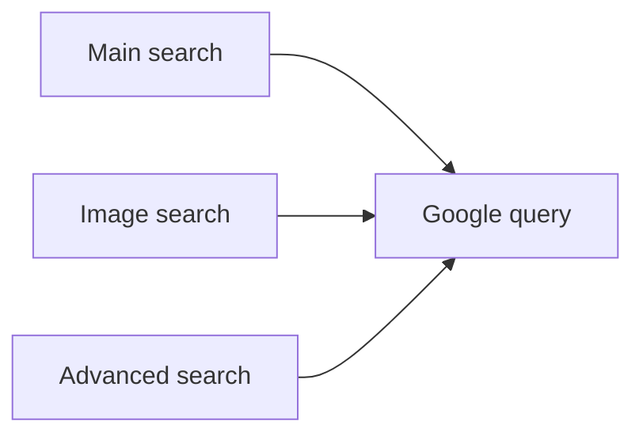

# Search Interfaces | CS50 Web Project

**HTML · CSS · form-based search**

A learning project recreating the familiar search, image-search and advanced-search entry points. It is a **front-end exercise**, not a search engine or a product associated with Google.

## Pages

- `index.html` — main search form
- `images-search.html` — image-search form
- An advanced-search page for multiple query operators

## Run

Open `index.html` in a browser (or use a static development server). The forms redirect to public search endpoints; no backend or customer data is stored by this repository.

[Video demonstration](https://youtu.be/OrLKCkPZeqY) · [Developer](https://github.com/matef-hub)

*Historical front-end exercise retained as part of a software-learning portfolio.*
